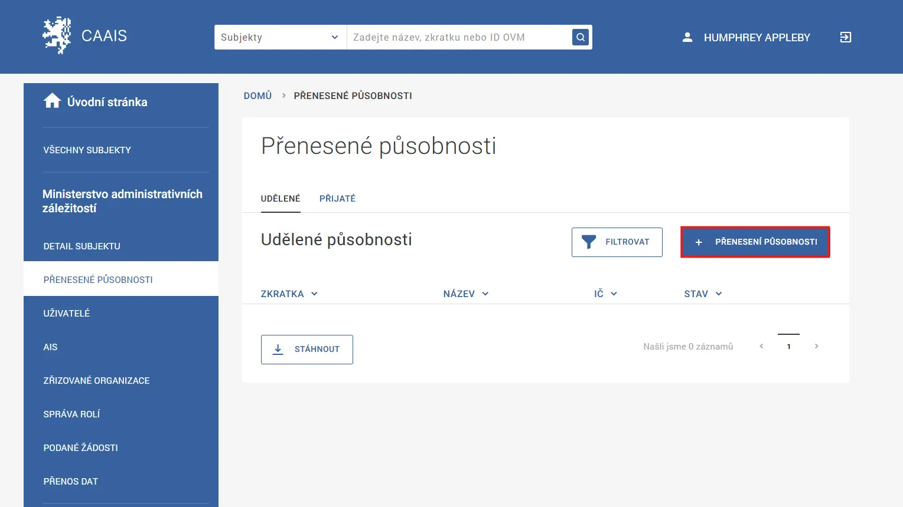
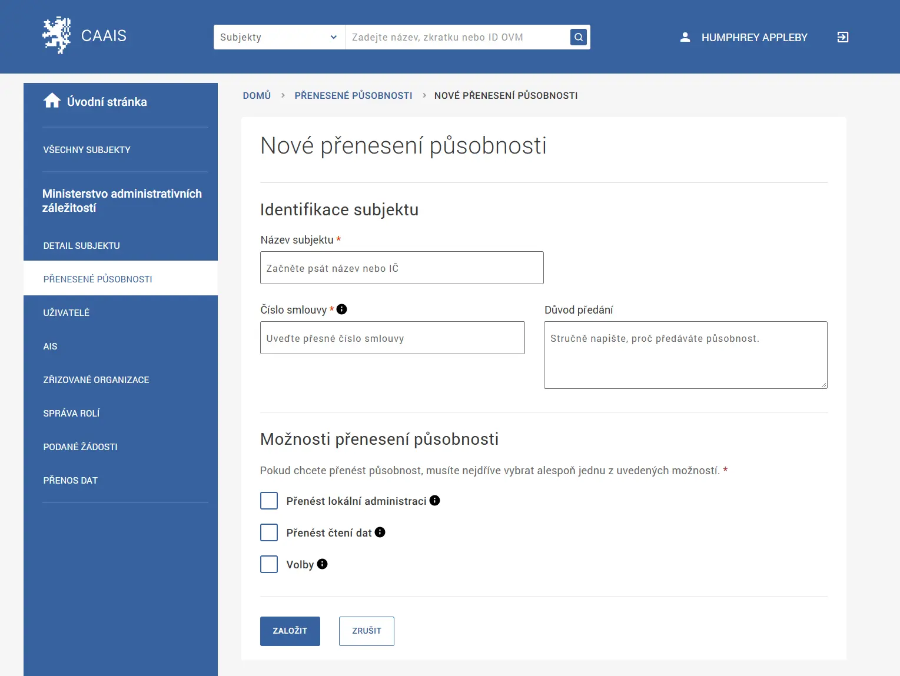
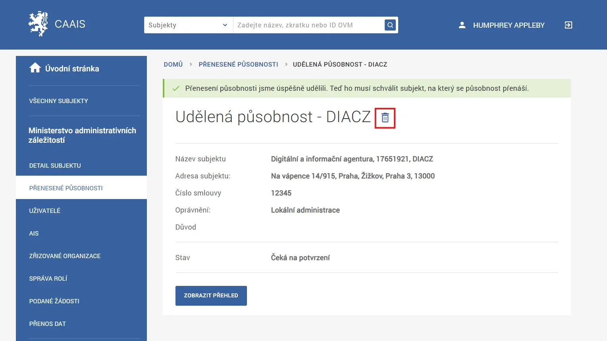
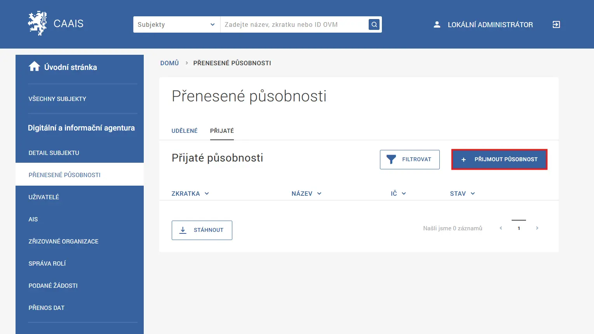
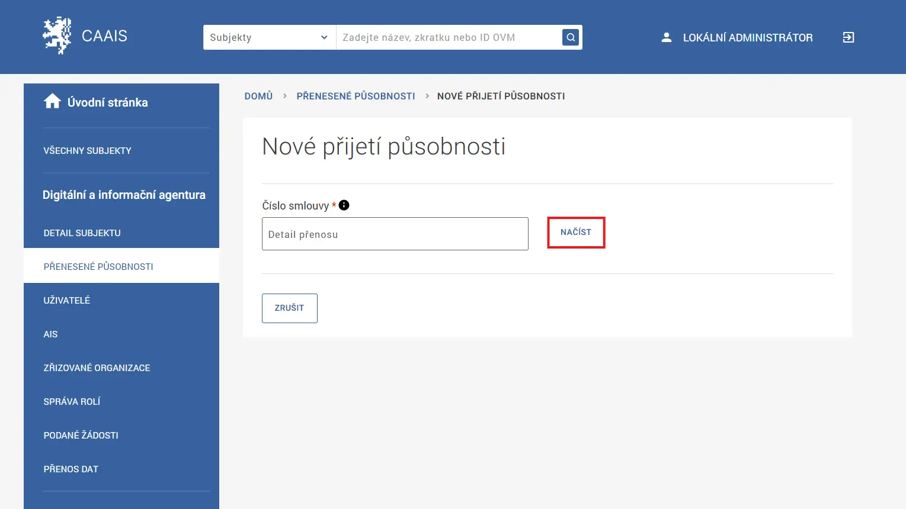
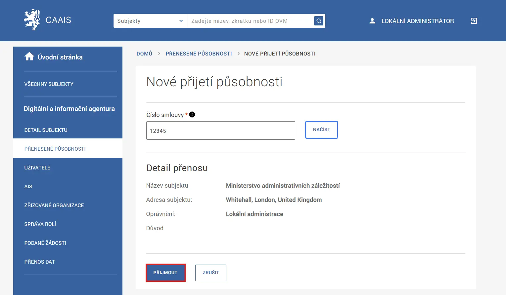
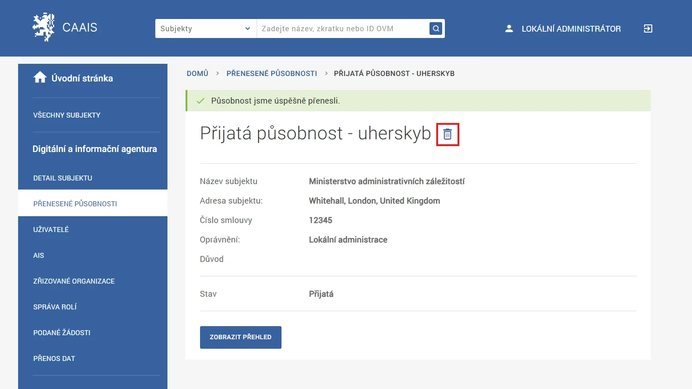

================================
Příručka lokálního administátora
================================

Přenesené působnosti
====================

V záložce **Přenesené působnosti** v levém menu lze udělit nebo přijmout přenesenou působnost z jiného subjektu, případně ji na jiný subjekt převést. Tento postup je vhodné využít například v případě, kdy na výchozím subjektu není aktuálně nikdo, kdo by mohl vykonávat funkci lokálního administrátora.

Udělení působnosti
------------------

Na záložce Udělené je zobrazen seznam všech udělených působností z aktuálního subjektu na jiné subjekty. Pro založení přenesené působnosti klikněte na tlačítko **+ Přenesení působnosti**. Po kliknutí se zobrazí formulář pro založení přenosu působnosti. 

Z nabídky Název subjektu vyberte subjekt, na který působnost přenášíte. Do pole Číslo smlouvy zadáte číslo, které bude identifikovat přenos. Toto číslo bude později použito pro přijetí působnosti jiným subjektem. Dále zvolte v Možnostech přenesení působnosti to, jakou působnost chcete přenést a formulář odešlete klinutím na Založit.

Založená přenesená působnost se zobrazí v seznamu Udělené působnosti. Detail jednotlivých záznamů slouží pro zjištění informací o přenesené působnosti na jiný subjekt. Zde můžete také působnost odebrat kliknutím na ikonu popelnice.

Přijaté působnosti
------------------

Pro zobrazení seznamu přijatých působností přejděte na záložku Přijaté. Pokud vám jiný subjekt udělil přenesenou působnost, můžete ji zde přijmout kliknutím na tlačítko **+ Přijmout působnost**.

Zobrazí se pole pro zadání čísla smlouvy o přenesení působnosti. Lokální administrátor vyplní číslo smlouvy a klikne na tlačítko **Načíst**.

Zobrazí se informace o přenosu a tlačítko **Přijmout** pro přijetí působnosti.

Po úspěšném přijetí působnosti se zobrazí informační hlášení. Na detailu jednotlivých záznamů jsou dostupné informace o přijaté působnosti. Všechny údaje jsou pouze pro čtení a nelze je editovat. Přijatou působnost lze pouze odebrat kliknutím na ikonu koše.

Od této chvíle má lokální administrátor v levém menu v záložce **Všechny subjekty** přístup k seznamu subjektů, u kterých může zobrazit nebo vykonávat lokální administraci v rozsahu oprávnění vyplývajících z přijaté přenesené působnosti.