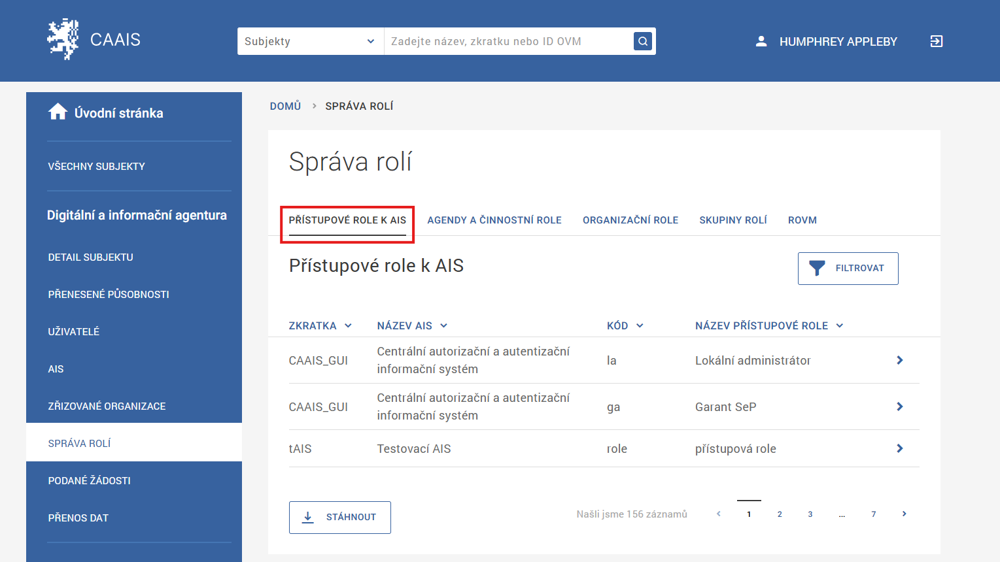
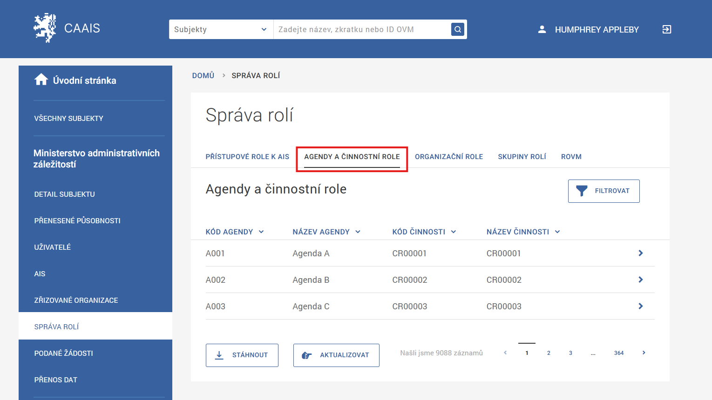
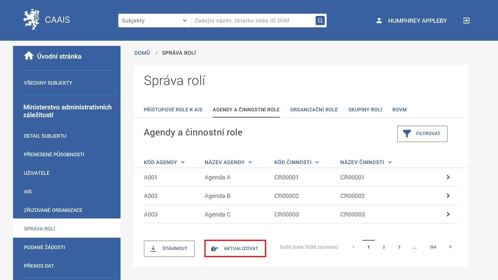

================================
Příručka lokálního administátora
================================

.. _sprava_roli_subjektu:

Správa rolí subjektu
====================

.. _pristupove_role_k_AIS:

Přístupové role k AIS
---------------------

Na záložce **Přístupové role k AIS** jsou zobrazeny záznamy všech přístupových rolí, kterými daný subjekt disponuje. Každý záznam obsahuje *Zkratku AIS*, *Název AIS*, *Kód* a *Název přístupové role*. Na základě všech těchto údajů můžete nad tabulkou filtrovat.

Kliknutím na záznam v tabulce můžete zobrazit detail konkrétní přístupové role.

.. dropdown:: Základní údaje

    Všechny atributy na záložce Základní údaje jsou needitovatelné.

    .. figure:: ../images/PLA_SRS_2.png
        :alt: Přístupové role k AIS – základní údaje
        :width: 1000px

.. dropdown:: Uživatelé

    Na záložce Uživatelé je tabulka všech uživatelů, kteří zobrazenou přístupovou rolí disponují. Zde také můžete přístupovou roli uživatelům přiřadit nebo odebrat po kliknutí na tlačítko Editovat. Po stisku tlačítka Editovat se zobrazí seznam všech uživatelů. Zde můžete hromadně přidat nebo odebrat role všem uživatelům, případně vybrat jednotlivé uživatele, kterým bude role přiřazena nebo odebrána.

    .. figure:: ../images/PLA_SRS_3.png
        :alt: Přístupové role k AIS – uživatelé
        :width: 1000px

    .. figure:: ../images/PLA_SRS_4.png
        :alt: Přístupové role k AIS – uživatelé (editace)
        :width: 1000px

.. _agendy_a_cinnostni_role:

Agendy a činnostní role
-----------------------

Na záložce **Agendy a činnostní role** jsou zobrazeny záznamy všech činnostních rolí, kterými daný subjekt disponuje. Každý záznam obsahuje *Kód agendy*, *Název agendy*, *Kód činnosti* a *Název činnosti*. Na základě všech těchto údajů lze nad tabulkou filtrovat.

V případě, že se Vám nezobrazuje kompletní seznam činnostních rolí kterými disponuje Vaše organizace, je možné tento seznam aktualizovat pomocí tlačítka **Aktualizovat 👉️**. Po kliknutí na toto tlačítko se provede aktualizace seznamu činnostních rolí, které jsou v daném okamžiku dostupné pro daný subjekt.

Kliknutím na záznam v tabulce můžetezobrazit detail konkrétní činnostní role.

.. dropdown:: Základní údaje

    Všechny atributy na záložce Základní údaje jsou needitovatelné.

    .. figure:: ../images/PLA_SRS_7.png
        :alt: Agendy a činnostní role – základní údaje
        :width: 1000px

.. dropdown:: Uživatelé

    Na záložce Uživatelé je seznam všech uživatelů, kteří zobrazenou činnostní rolí disponují. Zde také můžete činnostní roli uživatelům přiřadit nebo odebrat po kliknutí na tlačítko Editovat. Po stisku tlačítka Editovat se zobrazí seznam všech uživatelů daného subjektu. Zde můžete roli přidat hromadně všem uživatelům, také hromadně odebrat všem uživatelům, případně vybrat jednotlivé uživatele, kterým bude role přiřazena a odebrána.

    .. figure:: ../images/PLA_SRS_8.png
        :alt: Agendy a činnostní role – uživatelé
        :width: 1000px

    .. figure:: ../images/PLA_SRS_9.png
        :alt: Agendy a činnostní role – uživatelé (editace)
        :width: 1000px
